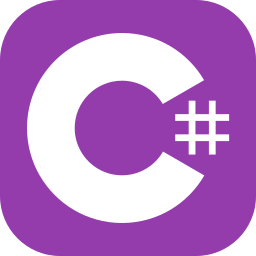
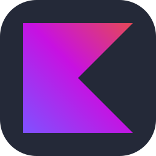
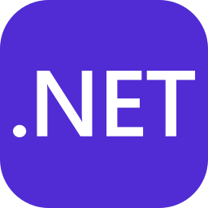
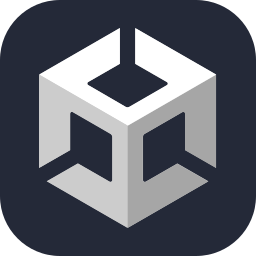
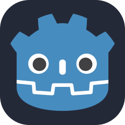
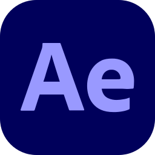
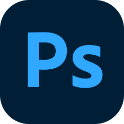
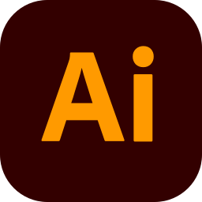
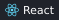

# Salut 👋
### Je suis Vincent Hottin, un étudiant en Techniques de l'informatique.
À la recherche d'un **stage pour la session d'hiver 2027**.

- 🎓 Cégep de Saint-Jean-sur-Richelieu, Québec
- 🎬 Montage vidéo dans mes temps libres
- 🏒 Joueur de hockey
- 🌐 Fluide en français et en anglais

Je m'intéresse surtout au côté visuel du développement :
- 🧊 Modélisation 3D
- 🎨 Conception d'interfaces UI/UX
- 🎮 Jeux vidéo

## Technologies

**Mon IDE préféré :**

**Langages**

**Frameworks**

**Outils**

## Projets

### 🌐 R*mble
Application de clavardage de bureau pour discuter avec vos amis et vos partenaires de jeu — en développement actif.

### 🖼️ Inspiration Library
Bibliothèque personnelle de captures d'écran de sites web et d'applications, classées par catégories et étiquettes, pour donner de meilleures références de design aux agents IA. Chaque capture est accompagnée d'un prompt de design UI et d'un prompt d'image, prêts à copier.

### ✴️ Agent Starter Kit
Ensemble de règles, de skills et de hooks réutilisables pour que les agents de programmation IA (Claude Code, Cursor, Copilot…) suivent les mêmes normes de code dans chaque projet.

## Me joindre

<b>English</b>

# Hi 👋
### I'm Vincent Hottin, a Computer Science Technology student.
Looking for an **internship for the Winter 2027 semester**.

- 🎓 Cégep de Saint-Jean-sur-Richelieu, Quebec
- 🎬 Video editing in my spare time
- 🏒 Hockey player
- 🌐 Fluent in French and English

I'm mostly interested in the visual side of development:
- 🧊 3D modeling
- 🎨 UI/UX design
- 🎮 Video games

## Technologies

**My favorite IDE:**

**Languages**

**Frameworks**

**Tools**

## Projects

### 🌐 R*mble
A desktop chat app for talking with your friends and gaming buddies, in active development.

### 🖼️ Inspiration Library
A personal library of website and app screenshots, sorted by category and tag, built to give AI agents better design references. Each screenshot comes with a UI brief prompt and a hero image prompt, ready to copy.

### ✴️ Agent Starter Kit
A reusable set of rules, skills and hooks so AI coding agents (Claude Code, Cursor, Copilot…) follow the same coding standards in every project.

## Contact

